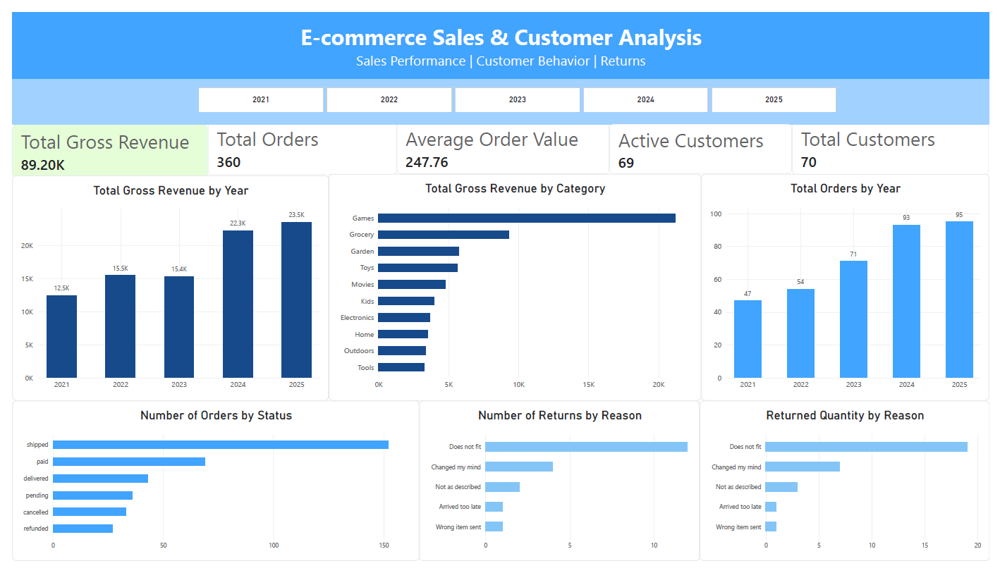

# E-commerce Sales & Customer Analysis

## Project Overview

This project explores e-commerce sales performance, customer activity, product categories, order statuses, and product returns using SQL and Power BI.

The goal of the project is to analyze the available data, identify key business patterns, and present the findings through an interactive Power BI dashboard.

The analysis was performed using a synthetic e-commerce dataset.

## Tools & Technologies

- **MySQL** – Used to query, clean, and analyze the e-commerce data.
- **SQL** – Used for data exploration, aggregation, joins, Common Table Expressions (CTEs), and window functions.
- **Power BI** – Used to build an interactive dashboard and visualize key business metrics.
- **DAX** – Used to create measures and calculate key performance indicators (KPIs).

## Dataset

The project uses a synthetic e-commerce dataset stored in a MySQL database named `ecommerce_sample`.

The database contains information about:

- Customers
- Orders and order statuses
- Products and product categories
- Order items and sales values
- Product returns and return reasons

The dataset covers the period from January 2021 to December 2025.

## Project Objectives

The main objectives of this project were to:

- Analyze sales performance and revenue trends over time.
- Identify the best-performing product categories and products.
- Examine order volume and order status distribution.
- Analyze customer activity and purchasing behavior.
- Explore product returns and identify the most common return reasons.
- Build an interactive Power BI dashboard to present key findings.

## SQL Analysis

SQL was used to explore and analyze the dataset through the following steps:

- **Database Exploration** – Examined database tables, columns, and relationships.
- **Order Analysis** – Analyzed order volume and order status distribution.
- **Revenue Analysis** – Calculated gross revenue and analyzed revenue by order status.
- **Product Analysis** – Identified top-performing products and product categories by revenue.
- **Time-Based Analysis** – Examined yearly revenue trends, average order value, and year-over-year (YoY) growth.
- **Customer Analysis** – Analyzed customer activity, repeat purchases, and order frequency.
- **Discount Analysis** – Examined order discounts and their distribution.
- **Returns Analysis** – Analyzed returned quantities, return statuses, and return reasons.

### SQL Techniques Used

- SELECT, WHERE, ORDER BY, GROUP BY
- Aggregate functions (SUM, COUNT, AVG)
- JOINs
- Common Table Expressions (CTEs)
- Window Functions
- CASE statements

## Power BI Dashboard

An interactive Power BI dashboard was developed to provide an overview of e-commerce performance.

The dashboard includes the following key performance indicators (KPIs):

- Total Gross Revenue
- Total Orders
- Average Order Value (AOV)
- Active Customers
- Total Customers

### Dashboard Visualizations

The dashboard presents:

- Gross revenue by year
- Gross revenue by product category (Top 10)
- Orders by year
- Orders by status
- Number of returns by reason
- Returned quantity by reason

### Interactivity

The dashboard includes interactive filters that allow users to explore data by year and product category.

## Key Findings

The analysis revealed several key findings:

- **Sales Performance:** Total gross revenue amounted to 89,195.02 across 360 orders.
- **Revenue Growth:** Revenue increased by 5.65% in 2025 compared to 2024.
- **Top Product Category:** Games generated the highest revenue, with 21,224.89.
- **Customer Activity:** 63 out of 69 customers made repeat purchases.
- **Product Returns:** A total of 20 return requests were recorded.
- **Return Reasons:** "Does not fit" was the most common return reason, accounting for 60% of all return requests.

## Limitations

- The dataset is synthetic and does not represent real-world business activity.
- The dataset contains a limited number of customers, orders, and return records.
- Gross revenue is calculated from order items before deducting order-level discounts.
- The findings should therefore be interpreted within the context of this dataset.
